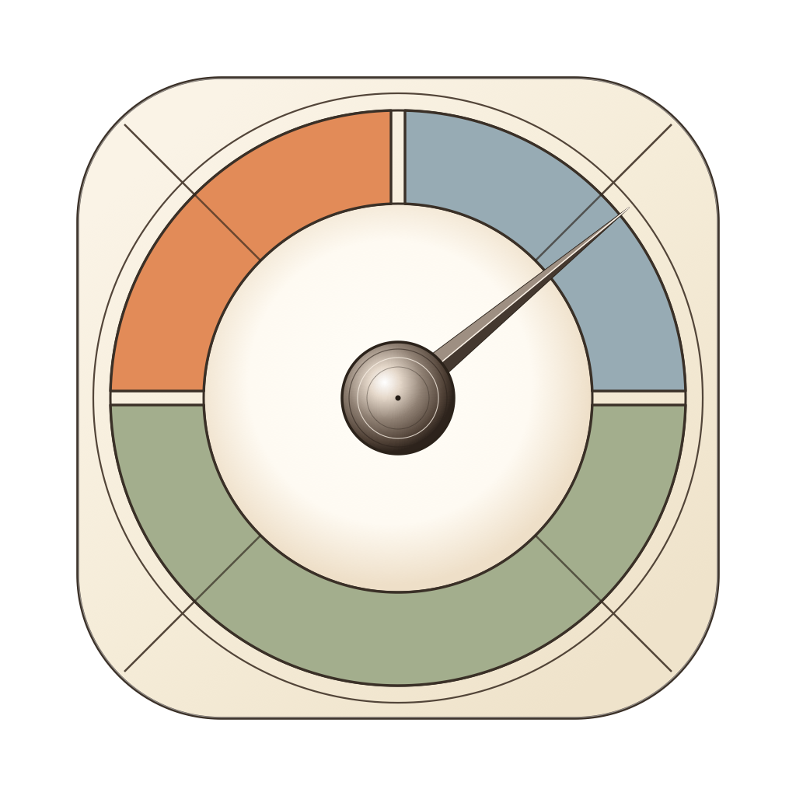
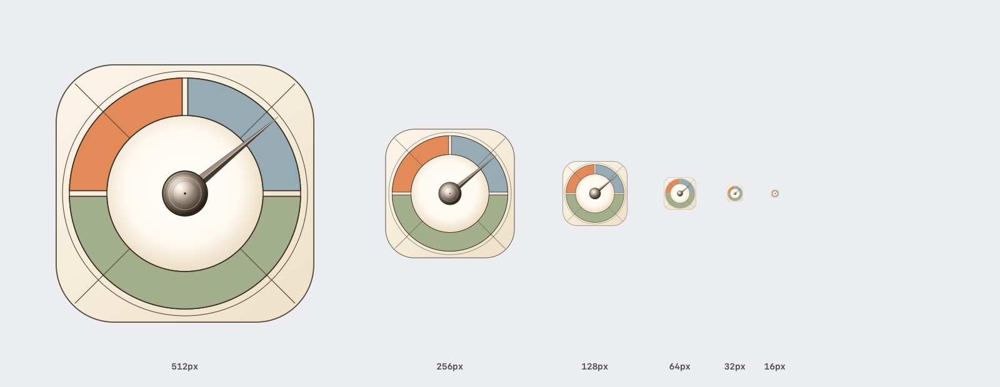

<p align="center">
  
</p>

# Pico

[](https://github.com/Ritolino/Pico)
[](https://github.com/Ritolino/Pico)
[](docs/BENCHMARKS_AND_DESIGN.md)
[](docs/BENCHMARKS_AND_DESIGN.md)
[](https://github.com/Ritolino/Pico/releases/tag/v1.0.0)
[](LICENSE)

Un monitor di sistema **ultraleggero, a zero overhead e privacy-first** per la barra dei menu di macOS, sviluppato su misura per i processori **Apple Silicon** (M1 / M2 / M3 / M4 / M5). Progettato come alternativa minimalista e amica della batteria rispetto alle pesanti suite di monitoraggio come *Stats* e *iStat Menus*.

[**🇬🇧 Read the README in English (README.md)**](README.md)

---

### ⬇️ Download Applicazione Precompilata (Nessuna Installazione Richiesta)

| Piattaforma | Hardware Supportato | Formato Pacchetto | Link per il Download |
| :--- | :--- | :--- | :--- |
| **🍏 macOS** | Apple Silicon (M1 / M2 / M3 / M4 / M5) | Bundle Standalone (.zip) | [**Scarica Pico v1.0.0 (.zip)**](https://github.com/Ritolino/Pico/releases/download/v1.0.0/Pico-v1.0.0-macOS.zip) |

*Scarica il file `.zip`, trascina `Pico.app` nella cartella `/Applications` e avvialo. Si configura automaticamente per l'avvio al login senza alcuna procedura manuale.*

---

## ✨ Funzionalità

- **🔒 100% Privato, Zero Telemetria & Zero Root**:
  - Funziona completamente offline: zero socket di rete, zero telemetria e zero tracciamento.
  - Non richiede **alcun privilegio di amministratore (`sudo`)**. Tutto viene eseguito in-process con normali permessi utente.
- **⚡ Ultraleggero (~15 MB RAM) & Zero CPU a Riposo (0.0%)**:
  - Mantiene un'impronta di memoria fisica di soli **~15 MB** (`phys_footprint`) — appena ~3 MB sopra la baseline minima del framework AppKit su macOS (`12 MB`).
  - Consumo **CPU dello 0.0% a riposo**: un unico timer coalesced a `3.0 secondi` campiona direttamente solo 3 contatori kernel.
  - **Zero Sottoprocessi**: Nessuna invocazione di `top`, `ps`, `vm_stat`, `ioreg` o `sysctl`. Azzerati i picchi di CPU, i cambi di contesto e il consumo di batteria.
- **📊 Tre Elementi Indipendenti in Barra (`NSStatusItem`)**:
  - Ordinamento deterministico da sinistra a destra: **CPU**, **GPU** e **RAM**.
  - Tipografia su due righe ad alta leggibilità con percentuali numeriche ingrandite e nitide (10.5 pt) ed etichette compatte (7.0 pt bold).
  - Centratura ottica verticale perfetta e allineata alle icone di sistema (Batteria, Wi-Fi, Centro di Controllo).
  - Rendering su template dinamico a singola istanza (larghezza fissa di 32 pt): zero jitter orizzontale e riduzione del backing store grafico da 11 MB a soli 384 KB.
  - Pienamente compatibile con tema Chiaro, tema Scuro e notch display dei MacBook Pro.
- **🔍 Menu Nativi On-Demand di Dettaglio (al Click)**:
  - Ancorati direttamente a filo contro il bordo inferiore della barra (risolto il bug dello spazio vuoto sui Mac con notch).
  - Le letture hardware costose si attivano **esclusivamente** a menu aperto (`1.0 s`) e vengono rilasciate all'istante alla chiusura:
    - **Menu CPU**: Utilizzo totale, scomposizione per cluster (**Super** ed **Efficiency** su M5), carico per singolo core, temperatura media, vero **Hotspot** del silicio e **Potenza Istantanea di Sistema in Watt (`W`)**.
    - **Menu GPU**: Utilizzo del motore grafico (`AGXAcceleratorG17G`), temperatura media GPU e Hotspot GPU.
    - **Menu RAM**: Memoria usata calcolata con la **Formula A** identica a Monitoraggio Attività (`Memoria App + Wired + Compressa`), dettaglio (`App`, `Wired`, `Compressa`, `File in cache`, `Libera`) e **Top 5 processi** per reale consumo di memoria in MB scansionati in < 2ms tramite buffer C a zero allocazioni.
- **🚀 Avvio Automatico al Login Nativo**:
  - Integrazione moderna con le API macOS Background Task Management (`SMAppService.mainApp`) per macOS 13+ (Ventura, Sonoma, Sequoia, Tahoe). Nessun demone in background o file plist superfluo.
- **🎯 Scorciatoie Dirette per Monitoraggio Attività**:
  - Azione rapida in ciascun menu per aprire Monitoraggio Attività già posizionato sulla scheda corrispondente (CPU, Memoria o Cronologia GPU).
- **🎨 Identità Vettoriale Rinascimentale ("The Gauge")**:
  - Icona geometrica originale ispirata ai disegni tecnici di Leonardo da Vinci, racchiusa nello squircle Apple HIG e con 3 settori cromatici funzionali: Terracotta (CPU), Azzurro (GPU) e Salvia (RAM).

---

## 📊 Pico a Confronto con gli Altri Monitor per macOS

| Caratteristica / Metrica | 🍏 **Pico** | **MenuMeters** | **Stats** | **iStat Menus** |
| :--- | :--- | :--- | :--- | :--- |
| **Impronta RAM Fisica** | **~15 MB** *(costanti)* | ~30 – 60 MB | **~100 – 250 MB** *(cresce con moduli e grafici)* | **~150 – 300 MB** *(app + demoni di supporto)* |
| **Sovraccarico RAM Relativo** | **Baseline (0%)** | **+100% a +300%** *(da 2× a 4× più pesante)* | **+550% a +1.550%** *(da 6× a 16× più pesante)* | **+900% a +1.900%** *(da 10× a 20× più pesante)* |
| **Consumo CPU a Riposo** | **0.0%** (timer 3.0s unico) | 0.3% – 1.0% | 0.5% – 2.0% | 1.0% – 3.0% |
| **Sottoprocessi Generati** | **0 (Nessuno)** | Nessuno | Invocazioni `ioreg`/`sysctl` | Demoni e helper in background |
| **Permessi di Root (`sudo`)** | **No** | No | No | Sì (helper demone privilegiato) |
| **Framework Interfaccia** | **AppKit Nativo Puro + C** | AppKit Legacy | SwiftUI + AppKit | AppKit + Demoni separati |
| **Accuratezza Formula RAM** | **Formula A Monitoraggio Attività** | vm_stat di base | Totale - Libera *(imprecisa)* | Totale - Libera |
| **Temperature & Watt Apple Silicon** | **Diodi per-core & PSTR** | Di base | Canali SMC | Helper demone SMC |
| **Allineamento Schermi Notch** | **A filo barra (Bugfix 0pt Gap)** | Menu staccato | Finestra fluttuante staccata | Menu staccato |
| **Motore Avvio al Login** | **`SMAppService` Nativo** | Login Items (Legacy) | Launch Agent | Helper Daemon |

*\*Nota sull'impatto reale: Suite come Stats e iStat Menus crescono rapidamente oltre i 200–250 MB quando vengono abilitati sensori termici, grafici storici e frequenze di campionamento elevate. Pico mantiene rigorosamente un'impronta stabile di ~15 MB poiché non accumula ring-buffer in memoria e interroga i sensori avanzati esclusivamente mentre il menu è aperto.*

---

## 🛠 Requisiti di Sistema

| Specifica | Requisito |
| :--- | :--- |
| **Sistema Operativo** | macOS 14.0 (Sonoma) o più recente *(pienamente compatibile con macOS 15 Sequoia / 27 Tahoe)* |
| **Architettura Hardware** | Solo Apple Silicon (`arm64` — M1, M2, M3, M4, M5, Pro, Max, Ultra) |
| **Impronta di Memoria** | `~15 MB` di memoria fisica residente (RAM) |
| **Permessi Richiesti** | Normale account utente (Nessun accesso root / Zero `sudo`) |

---

## 💡 Domande Frequenti (FAQ)

### Cosa differenzia Pico da Stats o iStat Menus?
La maggior parte dei monitor di sistema sono suite complesse con cronologie grafiche, animazioni e analizzatori di rete che occupano da 80 a 220 MB di RAM e svegliano costantemente la CPU dagli stati di risparmio energetico. Pico è pensato per chi desidera visualizzare in barra le percentuali istantanee di CPU, GPU e RAM con un impatto nullo sulle risorse (~15 MB di RAM, 0.0% CPU) e zero consumi di batteria.

### Come fa Pico a calcolare la RAM in modo così accurato?
Pico adotta esattamente la Formula A ufficiale di Monitoraggio Attività di Apple:
$$\text{Memoria Usata} = \text{Memoria App} + \text{Memoria Wired} + \text{Memoria Compressa}$$
Molte utility di terze parti calcolano la RAM sottraendo la memoria libera dal totale, conteggiando erroneamente i file della cache disco come "memoria usata" e allarmando inutilmente l'utente.

### Pico monitora le temperature dei singoli core e i Watt su Apple Silicon?
Sì. Cliccando sull'indicatore CPU o GPU vengono interrogati i diodi termici hardware (inclusi i singoli core Efficiency/Super e il vero Hotspot del silicio) e la potenza totale istantanea in Watt (`PSTR`) tramite chiamate in-process Mach, IOKit e AppleSMC, senza generare alcun sottoprocesso.

---

### 🎨 Identità Visiva — "The Gauge"

<p align="center">
  
</p>

Disegnato come uno strumento scientifico rinascimentale racchiuso nella geometria squircle concentrica delle linee guida Apple HIG:
- **Terracotta** (`#E28B58`): Quadrante superiore sinistro — calcolo CPU e potenza termica.
- **Azzurro Polvere** (`#97ABB4`): Quadrante superiore destro — accelerazione grafica GPU.
- **Verde Salvia** (`#A3AE8D`): Semicerchio inferiore — stabilità della memoria RAM.
- Diagonali tecniche a 45° con lancetta sfaccettata calibrata a 39.5°.

---

## 📖 Architettura e Benchmark

Per l'analisi ingegneristica completa, i grafici di memoria empirici e l'analisi trasparente delle scelte progettuali:
👉 **[Leggi Benchmark, Architettura e Scelte Ingegneristiche](docs/BENCHMARKS_AND_DESIGN.md)**

---

## 🛠 Compilazione e Installazione da Sorgente

Requisiti:
- macOS 13+ (Ventura, Sonoma, Sequoia, Tahoe / 27.2) su Apple Silicon.
- Command Line Tools (`clang` e `swiftc`). Nessuna installazione completa di Xcode richiesta.

```bash
# Clona il repository
git clone https://github.com/Ritolino/Pico.git
cd Pico

# Compila e installa direttamente in /Applications
./Scripts/install.sh
```

---

## 💡 Informazioni sul Progetto & Disclaimer

Questo progetto è stato ideato, progettato e collaudato da Gabriele Clemente ([@Ritolino](https://github.com/Ritolino)).

> **Trasparenza:** Non sono un ingegnere del software o un designer UI/UX professionista — sono un appassionato di tecnologia! Questa applicazione è stata architettata, scritta e rifinita attraverso pair programming uomo-AI utilizzando Google Antigravity potenziato da Gemini 3.8.
>
> Il mio contributo principale è stato l'ideazione del concetto iniziale, il testing iterativo, il design UI/UX, la definizione delle funzionalità e la validazione sul campo su hardware Apple Silicon (inclusa l'architettura pura in AppKit, le chiamate al kernel Mach, le interrogazioni IOKit ad AGXAccelerator, le letture termiche e di potenza AppleSMC, l'eliminazione dei memory leak, l'allineamento a filo barra sui display con notch e la localizzazione bilingue completa).
>
> Per questo motivo, suggerimenti, code review e Pull Request per migliorare il codice, ottimizzare la memoria o perfezionare l'architettura software sono calorosamente benvenuti e apprezzati!

---

## 📄 Licenza

Questo progetto è rilasciato sotto licenza [MIT](LICENSE).
