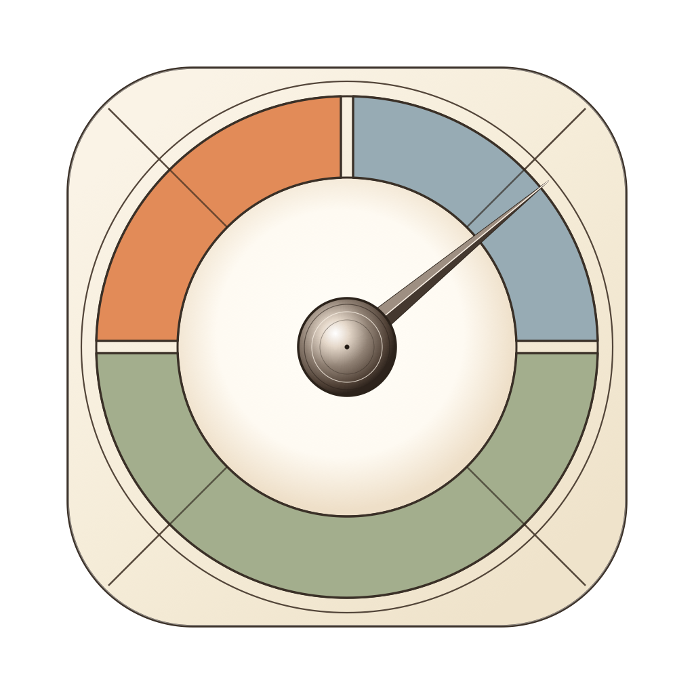
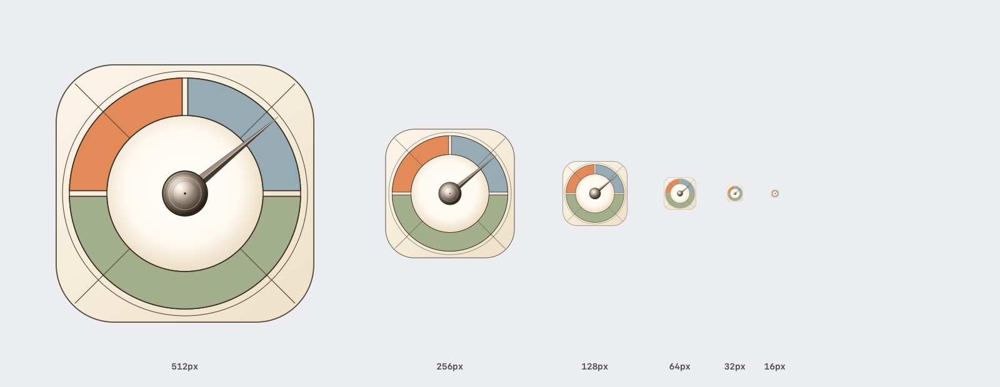

<p align="center">
  
</p>

# Pico

[](https://github.com/Ritolino/Pico)
[](https://github.com/Ritolino/Pico)
[](docs/BENCHMARKS_AND_DESIGN.md)
[](docs/BENCHMARKS_AND_DESIGN.md)
[](docs/BENCHMARKS_AND_DESIGN.md)
[](https://github.com/Ritolino/Pico/releases/tag/v1.1.0)
[](LICENSE)

An **ultra-lightweight, zero-overhead, privacy-first** system monitor for the macOS menu bar, purpose-built for **Apple Silicon** (M1 / M2 / M3 / M4 / M5). Designed from the ground up for **maximum battery efficiency and minimal RAM footprint** (~15 MB) via a `3.0 s` coalesced idle timer and `1.0 s` on-demand menu polling — a minimalist alternative to heavy monitoring suites like *Stats* and *iStat Menus*.

[**🇮🇹 Leggi il README in lingua italiana (README.it.md)**](README.it.md)

---

### ⬇️ Download Pre-built App (No Installation Required)

| Platform | Supported Hardware | Package Format | Download Link |
| :--- | :--- | :--- | :--- |
| **🍏 macOS** | Apple Silicon (M1 / M2 / M3 / M4 / M5) | Standalone Bundle (.zip) | [**Download Pico v1.1.0 (.zip)**](https://github.com/Ritolino/Pico/releases/download/v1.1.0/Pico-v1.1.0-macOS.zip) |

*Simply download the `.zip`, drag `Pico.app` into `/Applications`, and launch it. It automatically registers to launch at login with zero configuration.*

> [!NOTE]
> **First Launch (Ad-Hoc Signed App / Gatekeeper):** Because Pico is free and open-source without a paid Apple Developer notarization certificate, macOS may block the first opening of a browser-downloaded `.zip`.
> 1. Make sure `Pico.app` is inside **`/Applications`** (required by macOS for automatic Launch at Login).
> 2. **GUI (macOS 15 Sequoia / Tahoe):** Try opening `Pico.app` once and click **Done** → open **System Settings → Privacy & Security** → scroll to Security and click **Open Anyway**. *(On macOS 14 Sonoma, **Right-click → Open** once.)*
> 3. **Terminal alternative (1 command):** `xattr -dr com.apple.quarantine /Applications/Pico.app && open /Applications/Pico.app`

---

## ✨ Features

- **🔒 100% Private, Zero Telemetry & Zero Root**:
  - Operates completely offline with zero network sockets, zero analytics, and zero tracking.
  - Requires **no administrator privileges (`sudo`)**. Everything runs strictly in-process with standard user permissions.
- **🔋 Battery-First Dual-Loop Efficiency, ~15 MB RAM & Zero CPU Idle (0.0%)**:
  - **Coalesced Rest Loop (`3.0 s` + `500 ms` Leeway)**: In the background, Pico wakes only once every `3.0 seconds` using macOS timer coalescing (`500 ms` leeway) to sample strictly 3 counters (`CPU %`, `GPU %`, `RAM %`). This lets Apple Silicon CPU cores remain in deep low-power sleep (`C-states`), consuming just **0.26 s** of CPU time over 60 seconds (**0.0% idle CPU**).
  - **On-Demand Detail Loop (`1.0 s` Only While Open)**: Thermals, wattage, per-core loads, and top processes are **never** polled in the background. High-frequency `1.0 s` live updates run exclusively while a menu is open and stop completely the instant it closes.
  - **Ultra-Lightweight RAM (`~15 MB`)**: Maintains a constant physical footprint (`phys_footprint`) of just **~15 MB** — only ~3 MB above the bare macOS AppKit baseline (`12 MB`), with zero graph history buffers.
  - **Zero Subprocesses**: Never spawns `top`, `ps`, `vm_stat`, `ioreg`, or `sysctl`. Eliminates CPU spikes, context switching, and battery drain.
- **📊 Three Dedicated Menu Bar Indicators (`NSStatusItem`)**:
  - Deterministically ordered from left to right: **CPU**, **GPU**, and **RAM**.
  - High-legibility two-line typography with prominent enlarged percentages (10.5 pt) and compact category labels (7.0 pt bold).
  - Perfectly optically centered with macOS system status icons (Battery, Wi-Fi, Control Center).
  - Single-instance dynamic template rendering (32 pt fixed width): eliminates horizontal jitter and reduces image backing stores from 11 MB to just 384 KB.
  - Native support for Light Mode, Dark Mode, and MacBook Pro notch displays.
- **🔍 On-Demand Subsystem Menus (`1.0 s` Refresh Only When Clicked)**:
  - Attached directly flush against the menu bar (solving the macOS notch gap bug).
  - Zero background battery waste: expensive hardware queries activate at `1.0 s` **exclusively** while a menu stays open and deallocate immediately upon closing:
    - **Total CPU Menu**: Total usage, dynamic per-cluster breakdown (**Performance** / **Super** & **Efficiency** cores across M1–M5), individual core loads, average temperature, true silicon **Hotspot**, system **Thermal State** (`Nominal`–`Critical`), and real-time **System Power in Watts (`W`)**.
    - **GPU Menu**: Graphics engine utilization (`IOAccelerator` / `AGXAccelerator`, e.g. `G17G` on M5), average temperature, and GPU Hotspot.
    - **RAM Menu**: Used Memory matching Activity Monitor's **Formula A** (`App + Wired + Compressed`), memory breakdown (`App`, `Wired`, `Compressed`, `Cached Files`, `Swap Used`), and **Top 5 processes** by real memory footprint in MB scanned in < 2ms via zero-allocation C buffer.
- **🚀 Native macOS Launch-at-Login**:
  - Built-in integration with modern macOS Background Task Management (`SMAppService.mainApp`) on macOS 13+ (Ventura, Sonoma, Sequoia, Tahoe). No background daemons or helper plist clutter.
- **🎯 Activity Monitor Quick Shortcuts**:
  - Direct menu actions to open macOS Activity Monitor pre-navigated to CPU, Memory, or GPU History tabs.
- **🎨 Custom Renaissance Vector Identity ("The Gauge")**:
  - Handcrafted technical gauge design inspired by Leonardo da Vinci's scientific sketches, featuring Apple HIG squircle geometry and functional color sectors: Terracotta (CPU), Azzurro (GPU), and Salvia (RAM).

---

## 📊 Pico vs. Other macOS System Monitors

| Feature / Metric | 🍏 **Pico** | **MenuMeters** | **Stats** | **iStat Menus** |
| :--- | :--- | :--- | :--- | :--- |
| **Physical RAM Footprint** | **~15 MB** *(constant)* | ~30 – 60 MB | **~100 – 250 MB** *(scales with modules)* | **~150 – 300 MB** *(app + daemons)* |
| **Relative Memory Overhead** | **Baseline (0%)** | **+100% to +300%** *(2× to 4× larger)* | **+550% to +1,550%** *(6× to 16× larger)* | **+900% to +1,900%** *(10× to 20× larger)* |
| **Idle CPU Usage** | **0.0%** (3.0s coalesced) | 0.3% – 1.0% | 0.5% – 2.0% | 1.0% – 3.0% |
| **Polling & Battery Strategy** | **`3.0s` coalesced idle + `1.0s` on-demand** *(Zero drain)* | Continuous fixed polling | Continuous polling + live charts | Continuous daemon polling + charts |
| **Subprocesses Spawned** | **0 (None)** | None | Spawns `ioreg`, `sysctl` | Background daemons |
| **Root (`sudo`) Required** | **No** | No | No | Yes (Privileged helper) |
| **UI Framework** | **Pure Native AppKit + C** | Legacy AppKit | SwiftUI + AppKit | AppKit + Daemons |
| **RAM Formula Accuracy** | **Activity Monitor Formula A** | Basic vm_stat | Total - Free (inaccurate) | Total - Free |
| **Apple Silicon Thermals & Watts** | **Per-core diodes & PSTR** | Basic | SMC sensors | Helper SMC |
| **Notch Display Margin Alignment** | **Flush (Zero Notch Gap Bugfix)** | Detached menu | Detached floating window | Detached menu |
| **Launch at Login Engine** | **Native `SMAppService`** | Legacy Login Items | Launch Agent | Helper Daemon |

*\*Real-world memory notes: Suites like Stats and iStat Menus grow rapidly from ~100 MB up to 250+ MB when thermal sensors, live graphs, and frequent sampling are enabled. Pico maintains a strictly constant ~15 MB footprint because it stores zero graph history buffers in memory and queries high-overhead sensors strictly while an NSMenu is open.*

---

## 🛠 System Requirements

| Specification | Requirement |
| :--- | :--- |
| **Operating System** | macOS 14.0 (Sonoma) or newer *(macOS 15 Sequoia / 27 Tahoe fully supported)* |
| **Hardware Architecture** | Apple Silicon only (`arm64` — M1, M2, M3, M4, M5, Pro, Max, Ultra) |
| **Memory Footprint** | `~15 MB` resident physical RAM |
| **Privileges** | Standard user permissions (Zero root / No `sudo`) |

---

## 💡 Frequently Asked Questions (FAQ)

### What makes Pico different from Stats or iStat Menus?
Most system monitors are feature-heavy suites with graph histories, animations, and network sniffers that consume 100–300 MB of RAM and constantly wake the CPU. Pico is designed for users who want clean, instant CPU, GPU, and RAM percentages in their menu bar with virtually zero resource cost (~15 MB RAM, 0.0% CPU) and maximum battery longevity.

### How does Pico maximize MacBook battery life? (Why 3.0s idle / 1.0s open?)
Pico is engineered to be **100% efficient on battery, not just RAM**. In the background, the menu bar uses a single coalesced timer every **`3.0 seconds`** (with a `500 ms` macOS leeway) to read only 3 kernel counters (`CPU %`, `GPU %`, `RAM %`) — consuming just **0.26 s** of CPU core time over a full minute and letting Apple Silicon cores stay in deep sleep (`C-states`). Expensive queries (per-core loads, thermal diodes, system power in Watts, and top processes) are **completely turned off at rest**, activating at **`1.0 s`** only while a menu is open.

### How does Pico calculate RAM usage accurately?
Pico implements Apple's exact Activity Monitor Formula A:
$$\text{Used Memory} = \text{App Memory} + \text{Wired Memory} + \text{Compressed Memory}$$
Many third-party tools subtract Free Memory from Total Memory, incorrectly counting cached disk files as "used memory" and leading users to believe their RAM is exhausted.

### Does Pico monitor CPU temperatures and wattage on Apple Silicon?
Yes. Clicking the CPU or GPU indicator queries hardware thermal diodes (including individual efficiency/performance cores and true silicon Hotspot) and total instantaneous system power in Watts (`PSTR`) via in-process Mach, IOKit, and AppleSMC calls, with zero subprocess overhead.

### Why does macOS show an "Apple could not verify…" warning on first launch?
Pico is signed with a free local ad-hoc signature (`codesign -s -`) rather than a paid Apple Developer Program notarization certificate, so macOS Gatekeeper flags browser-downloaded `.zip` archives on first launch. The entire Swift + C source code is inspectable in this repository: you can either build locally in seconds (`./Scripts/install.sh`, no Gatekeeper prompt) or allow the downloaded bundle once in **System Settings → Privacy & Security → Open Anyway** (after dragging `Pico.app` into `/Applications`).

---

### 🎨 Visual Identity — "The Gauge"

<p align="center">
  
</p>

Designed as a Renaissance scientific instrument encapsulated in Apple HIG concentric squircle geometry:
- **Terracotta** (`#E28B58`): Top-left quadrant — CPU computation and thermal power.
- **Azzurro Polvere** (`#97ABB4`): Top-right quadrant — GPU graphics acceleration.
- **Verde Salvia** (`#A3AE8D`): Lower semicircle — RAM memory stability.
- Precision 45° technical radial diagonals across all sectors and a faceted needle set at 39.5°.

---

## 📖 Architecture & Benchmarks

For full technical documentation, empirical memory charts, and an honest analysis of design trade-offs:
👉 **[Read Benchmarks, Architecture & Engineering Design](docs/BENCHMARKS_AND_DESIGN.md)**

---

## 🛠 Compilation and Installation from Source

Requirements:
- macOS 13+ (Ventura, Sonoma, Sequoia, Tahoe / 27.2) on Apple Silicon.
- Command Line Tools (`clang` and `swiftc`). No full Xcode installation required.

```bash
# Clone the repository
git clone https://github.com/Ritolino/Pico.git
cd Pico

# Build and install directly into /Applications
./Scripts/install.sh

# Optional: inspect metrics or export JSON from the CLI
/Applications/Pico.app/Contents/MacOS/Pico --dump-metrics
/Applications/Pico.app/Contents/MacOS/Pico --json
```

---

## 💡 About this Project & Disclaimer

This project was conceived, designed, and tested by Gabriele Clemente ([@Ritolino](https://github.com/Ritolino)).

> **Full Disclosure:** I am not a professional software engineer or UI/UX designer — I'm a passionate tech enthusiast! This application was architected, written, and refined through human-AI pair programming using Google Antigravity powered by Gemini 3.8.
>
> My primary contribution has been the initial concept, iterative testing, UI/UX design, feature scoping, and real-world verification on Apple Silicon hardware (including pure AppKit architecture, Mach kernel calls, IOKit accelerator queries, AppleSMC power rails, memory leak elimination, notch display margin alignment, and complete bilingual localization).
>
> Because of this, suggestions, code reviews, and Pull Requests to improve the codebase, optimize memory, or enhance software architecture are warmly welcomed and appreciated!

---

## 📄 License

This project is licensed under the [MIT License](LICENSE).
